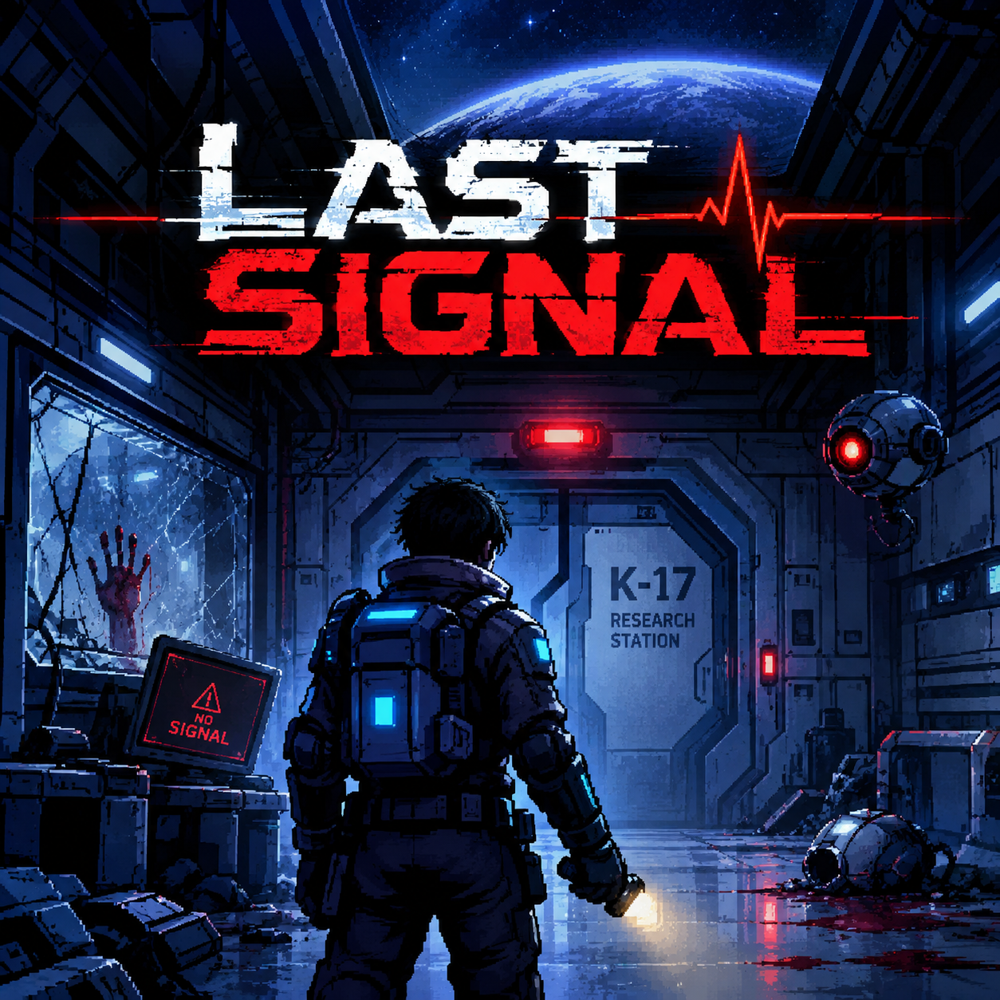

# آخرین سیگنال — Last Signal



> «مأموریت کامل شد — سیگنال اضطراری در راه است. ایستگاه K-17 پیدا خواهد شد.»

## داستان

ایستگاه تحقیقاتی K-17 دیگر جواب نمی‌دهد. چراغ‌ها خاموش‌اند، راهروها خالی‌اند و از خدمه خبری نیست. تو تنها کسی هستی که هنوز اینجاست — و تنها راه نجات، فرستادن یک سیگنال اضطراری است.

برای این کار باید هر سه دکل مخابراتی ایستگاه را دوباره روشن کنی؛ در حالی که ربات‌های امنیتی هنوز در راهروها گشت می‌زنند، درها قفل‌اند و ایستگاه با هر قدمی که برمی‌داری ساکت‌تر می‌شود. این بازی درباره‌ی تنهایی است: تنهاییِ کسی که در یک ایستگاه مرده، دنبال یک صدا می‌گردد — و آن صدا، آخرین سیگنال است.

## بازی

- **نما:** نمای بالا، دوبعدی، پیکسل‌آرت
- **ایستگاه:** ۵ منطقه — کنترل مرکزی، آزمایشگاه، حیاط، بخش پزشکی، نیروگاه
- **هدف:** روشن کردن ۳ دکل مخابراتی و فرستادن سیگنال اضطراری از فرستنده‌ی کنترل مرکزی
- **دشمن‌ها:** ربات‌های امنیتی و اسکنر که در منطقه‌ی خودشان گشت می‌زنند؛ اگر تو را ببینند، به چک‌پوینت برمی‌گردی
- **مکانیک امضا — پالس رادار:** کلید `Q` — حلقه‌ای به شعاع ۱۶۰ پیکسل که اشیای مخفی را آشکار می‌کند و ربات‌هایی را که موج به آن‌ها می‌رسد ۲ ثانیه مختل می‌کند (جرقه می‌زنند، نمی‌بینند و نمی‌توانند بگیرند)؛ ۵ ثانیه کول‌داون و ۱۵ واحد باتری
- **نقشه‌ی زنده:** کلید `M` — پنج منطقه با رنگ‌های جدا، وضعیت دکل‌ها، کشفیات پنهان بعد از پالس رادار، و موقعیت دشمن‌ها تا ۶ ثانیه بعد از پالسی که به آن‌ها رسیده باشد
- **بخش پزشکی (v1.4):** کف و دیوارهای تازه، مانیتور علائم حیاتی، و یک فیوز پنهان (در کنترل مرکزی، نزدیک حجره‌ی کنسول B) که فقط با رادار پیدا می‌شود

## کنترل‌ها

- `W A S D` یا کلیدهای جهت‌دار — حرکت
- `E` — تعامل: روشن کردن دکل، فرستادن سیگنال
- `Q` — پالس رادار
- `M` — نقشه‌ی زنده
- `Esc` — مکث

## فنی

- **موتور:** `Godot 4.7.2` — `GDScript`
- **رابط کاربری:** کاملاً فارسی — فونت وزیرمتن، راست‌به‌چپ، با صفحه‌ی راهنما از منوی اصلی و منوی مکث
- **گرافیک:** پیکسل‌آرت از دیتاست `CC0` ‏`Angais/pixel-art-atlas-1.4m`‏ به‌همراه طراحی دستی (دیوارهای فلزی و درها دست‌ساز‌اند)
- **تست:** ۶۶۱ تست `headless` — همه پاس
- **نسخه‌ی فعلی:** `v1.4` — بخش پزشکی با پک ۸۳ اسپرایتی

## اجرا

**ویندوز:** فایل `LastSignal_Windows_v1.4.zip` را دانلود و استخراج کن و `LastSignal.exe` را اجرا کن.

**با Godot:** پروژه را با `Godot 4.7.2` باز کن و اجرا بگیر.

## ساختار پروژه

```
project.godot          تنظیمات پروژه و کلیدها
scenes/                صحنه‌ها — منو، مراحل، پایان
scripts/               منطق بازی — بازیکن، ربات‌ها، رادار، مأموریت
assets/                اسپرایت‌ها و صداها
medical-wing-pack/     پک ۸۳ اسپرایتی بخش پزشکی (v1.4)
docs/                  مستندات و کاور بازی
releases/              خروجی‌های آماده‌ی ویندوز
tools/                 ابزارهای کمکی
```
